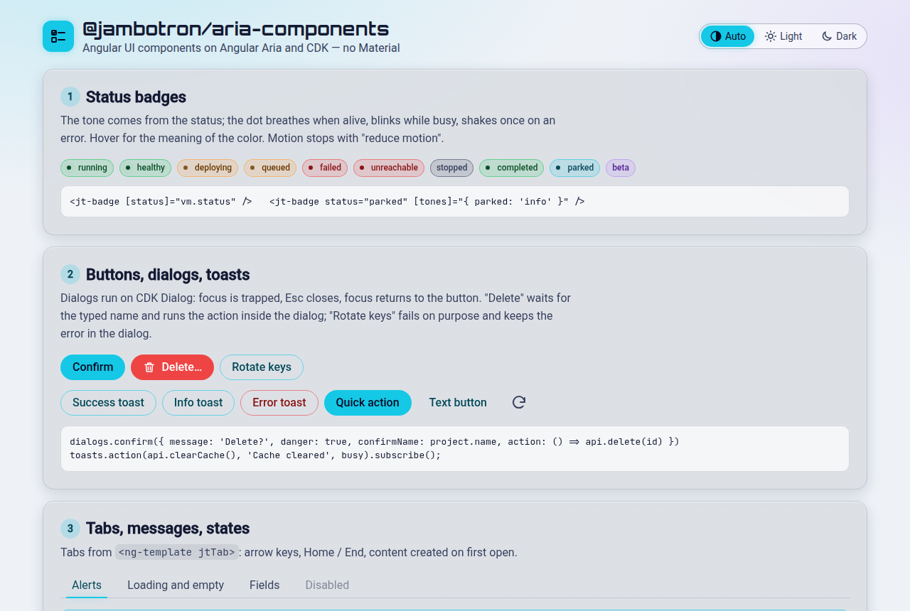
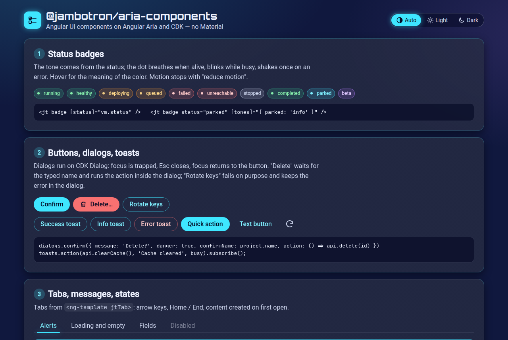
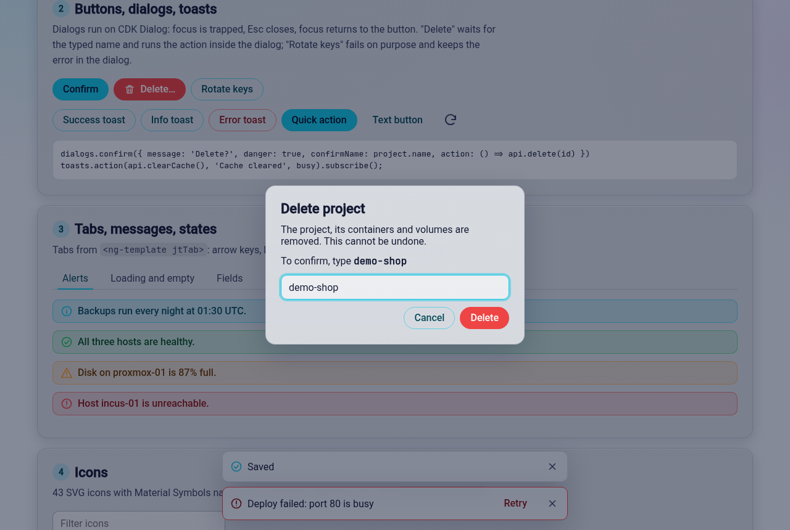
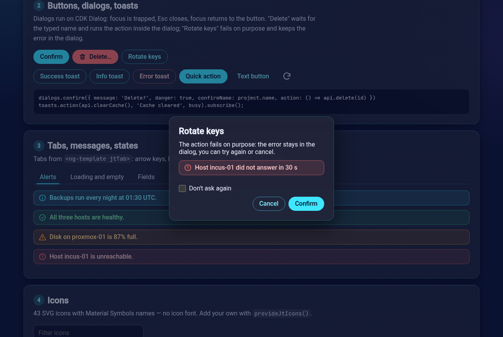
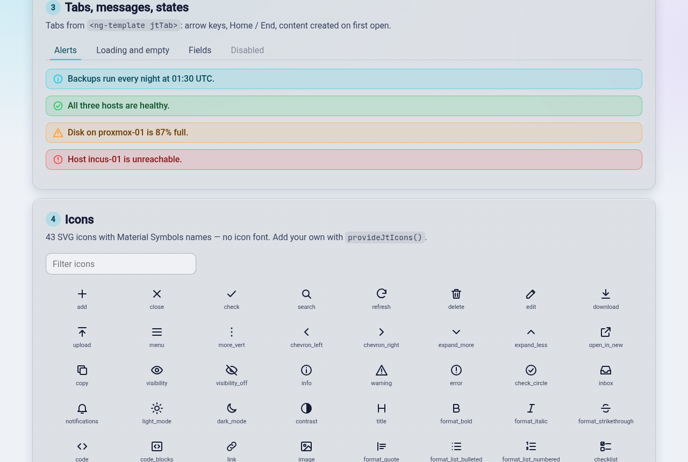

## Abstract

This article is a practical guide to **@jambotron/aria-components**, the small set of Angular UI components and design tokens behind jambotron.com. It shows how to use them: installing the package, turning on the light and dark theme, and using the icons, status badges, buttons, confirmation dialogs, toasts, tabs, alerts, loading and empty states and the password toggle. Every component sits on Angular Aria or the Angular CDK. None of them needs Angular Material. A live demo with four sections and three themes (auto, light, dark) is deployed on Jambotron from one Docker Compose file.

**Keywords:** Angular, UI components, Angular Aria, Angular CDK, accessibility, dark theme, CSS variables, dialogs, toasts, icons.

---

## 1. Introduction

Every admin app needs the same small pieces: a badge that says "running" in green, a "Delete?" dialog that is hard to click by mistake, a toast after "Save", tabs, an empty list that tells you what to do. Angular Material has many of them, but it brings its own look, a large theme system and a lot of code. [Angular Aria](https://angular.dev/guide/aria/overview) takes the opposite approach. It gives you headless, accessible patterns (tabs, listbox, menu, toolbar, grid) and leaves the look to you.

@jambotron/aria-components is that look, plus the pieces Aria does not have:

| Piece | Built on |
|---|---|
| Theme: `--jt-*` tokens, light and dark | CSS variables |
| `<jt-icon>`: 43 SVG icons | inline SVG, no icon font |
| `<jt-badge>`: status badge | — |
| `.jt-button`: filled, outlined, text, danger, icon | CSS classes on `<button>` |
| `JtDialogService` and `confirm()` | CDK Dialog |
| `JtToastService` | own toaster with `aria-live` |
| `<jt-tabs>` | Aria `tabs` |
| `<jt-theme-toggle>` | Aria `listbox` |
| `<jt-alert>`, `<jt-loading-state>`, `<jt-spinner>`, `<jt-empty-state>`, `<jt-password-toggle>` | — |

These components grew inside jambotron.com and were moved into a package. The [data grid](https://aria-grid-demo.jambocheck.com) and the [Markdown editor](https://aria-markdown-editor-demo.jambocheck.com) are separate packages that share the same tokens.



---

## 2. The demo

| Section | What it shows |
|---|---|
| 1. Status badges | Ten statuses, a custom status with its own tone, a label without a dot |
| 2. Buttons, dialogs, toasts | A simple confirmation; "Delete" with a typed name and an action inside the dialog; "Rotate keys" that fails on purpose; three kinds of toasts; a quick action with a busy flag |
| 3. Tabs, messages, states | `<jt-tabs>` with four tabs (one disabled): alerts, loading and empty states, password fields |
| 4. Icons | All icons with a filter, and the empty state when nothing matches |

At the top, `<jt-theme-toggle>` switches the theme.

---

## 3. Installation

### 3.1 Requirements

Angular 22 with `@angular/aria`, `@angular/cdk` and `rxjs`. Angular Material is not needed.

### 3.2 The package

The package is published in the public npm registry of our Gitea. No token is needed:

```
# .npmrc
@jambotron:registry=https://gitea.jambotron.com/api/packages/jambotron_gang/npm/
```

```bash
npm install @jambotron/aria-components @angular/aria @angular/cdk
```

### 3.3 Styles

One line in the global styles brings the tokens, the classes and the CDK overlay styles the dialogs need:

```scss
@use '@jambotron/aria-components/styles/aria-components';
```

If you only want the colors for your own classes, use `@use '@jambotron/aria-components/styles/theme';`.

---

## 4. Theme

### 4.1 Tokens

Colors, radii, spacing, fonts, shadows and durations are CSS variables: `--jt-accent`, `--jt-text`, `--jt-surface`, `--jt-danger`, `--jt-radius-md`, `--jt-space-3` and so on. They are declared on `:where(:root)`, which has zero specificity. Any value your app sets wins without `!important`:

```css
:root { --jt-accent: #7c3aed; --jt-radius-md: 4px; }
```

The palette is the one of jambotron.com: night-blue glass with a cyan accent, gold and violet as second and third accents. The text contrast was checked against WCAG AA.

### 4.2 Light and dark

The dark theme turns on in two ways:

- by the system setting (`prefers-color-scheme: dark`) when `<html>` has no `data-theme`;
- explicitly with `<html data-theme="dark">` or `data-theme="light"`.

`JtThemeService` manages this. `choice` is `'auto'`, `'light'` or `'dark'`. It is kept in `localStorage`, and `theme` is the theme in effect. `<jt-theme-toggle>` is the ready switch (add `[compact]="true"` for icons only). To avoid a flash of the wrong theme before Angular starts, put this in `index.html`:

```html
<script>
  try { var t = localStorage.getItem('jt-theme');
        if (t === 'light' || t === 'dark') document.documentElement.dataset.theme = t; } catch (e) {}
</script>
```



---

## 5. Icons

```html
<jt-icon name="delete" />                       <!-- decorative: aria-hidden -->
<jt-icon name="warning" label="Disk almost full" />  <!-- meaningful: role="img" + label -->
<jt-icon name="refresh" [size]="18" />
```

The 43 icons are drawn as SVG paths on a 24×24 grid with a 2px round stroke, in `currentColor`. Names follow Material Symbols (`check_circle`, `visibility_off`, `format_bold`), so moving from Material icons is easy. No icon font is loaded. Add your own icons with paths in the same grid:

```ts
providers: [provideJtIcons({ rocket: ['M12 2c3 3 4 7 4 11l-4 4-4-4c0-4 1-8 4-11z', 'M9 18l-2 4M15 18l2 4'] })]
```

---

## 6. Status badges

```html
<jt-badge [status]="vm.status" />
```

The tone comes from the status, without case: `running`, `healthy`, `completed` → green; `deploying`, `queued`, `paused` → amber; `failed`, `unreachable` → red; `stopped`, `deleted` → grey. The dot moves with the tone. It **breathes** for things that are alive (`running`, `healthy`), **blinks** while something is in progress, and **shakes** once when an error appears. With "reduce motion" turned on in the system, the dot stays still. The tooltip explains the color ("Error", "In progress or needs attention") unless you pass `hint`.

Your own statuses: `[tones]="{ parked: 'info' }"`. A fixed tone and text: `<jt-badge tone="accent" label="beta" [dot]="false" />`.

---

## 7. Buttons

Buttons are plain `<button>` elements with classes. There is no wrapper component, so forms, `type="submit"` and `disabled` work as usual:

```html
<button class="jt-button jt-button--filled">Save</button>
<button class="jt-button jt-button--outlined">Cancel</button>
<button class="jt-button jt-button--filled jt-button--danger"><jt-icon name="delete" [size]="18" /> Delete</button>
<button class="jt-button">Text button</button>
<button class="jt-icon-button" aria-label="Refresh"><jt-icon name="refresh" /></button>
```

Focus is shown with the theme's focus ring, and only for keyboard focus (`:focus-visible`).

---

## 8. Dialogs

### 8.1 Confirmation

`JtDialogService.confirm()` replaces `window.confirm()`. It returns an `Observable<boolean>`: `true` when confirmed, `false` on Cancel, Esc or a click outside.

```ts
private readonly dialogs = inject(JtDialogService);

remove(project: Project) {
  this.dialogs.confirm({
    title: 'Delete project',
    message: 'The project, its containers and volumes are removed.',
    danger: true,
    confirmName: project.name,
    confirmLabel: 'Delete',
    action: () => this.api.delete(project.id)
  }).subscribe(done => done && this.toasts.success('Deleted'));
}
```

What the options do:

- `danger`: the button is red, and the dialog gets `role="alertdialog"`.
- `confirmName`: the button stays disabled until the name is typed. Use it for irreversible actions.
- `action`: the work runs **inside the dialog**. The buttons turn into a spinner, the dialog cannot be closed, and on an error the dialog stays open with the error text. The user can try again or cancel.
- `dontAsk: true`: a "Don't ask again" checkbox. `confirmWithResult()` returns `'always'` when it is ticked. Where you store the choice is up to you.





### 8.2 Keyboard

The dialogs run on CDK Dialog. Focus moves into the dialog (to the name field, or to the confirm button) and cannot leave it with Tab. Esc closes the dialog. When it closes, focus returns to the button that opened it. We checked this in the demo with a script driving Chrome: after "Rotate keys" fails and Esc closes the dialog, focus is back on "Rotate keys".

### 8.3 Your own dialog

```ts
const ref = this.dialogs.open<string>(RenameDialog, { data: { name } });
ref.closed.subscribe(newName => …);
```

Inside, read `inject(DIALOG_DATA)`, close with `inject(DialogRef).close(result)` and put `class="jt-dialog"` on the root element for the glass surface. `.jt-dialog__title` and `.jt-dialog__actions` give the usual layout.

---

## 9. Toasts

```ts
private readonly toasts = inject(JtToastService);

this.toasts.success('Saved');                       // 3 s
this.toasts.info('Backup starts at 01:30 UTC');     // 4 s
this.toasts.error('Deploy failed: port 80 is busy', 'Retry')   // 8 s, with a button
  .onAction.subscribe(() => this.deploy());
```

You do not place a toaster in a template. It is added to `<body>` with the first toast. At most three toasts are shown, and the oldest leaves first. Errors are in an `aria-live="assertive"` region, so a screen reader reads them at once. Other toasts are polite.

For the most common case, a button that calls the server, there is `action()`:

```ts
readonly busy = signal(false);

clearCache() {
  this.toasts.action(this.api.clearCache(), 'Cache cleared', this.busy, 'Could not clear the cache').subscribe();
}
```

`busy` is `true` while the request runs (disable the button, show `<jt-spinner>`). Success shows the message. Failure shows "Could not clear the cache: " plus the server's message, and the error goes no further, so the subscriber only sees success.

---

## 10. Tabs

Angular Aria's tabs need a tab list, tabs and panels with matching values. `<jt-tabs>` writes that markup for you from templates:

```html
<jt-tabs [(selected)]="tab" label="Project">
  <ng-template jtTab="overview" label="Overview">…</ng-template>
  <ng-template jtTab="logs" label="Logs"><app-logs /></ng-template>
  <ng-template jtTab="danger" label="Danger zone" [disabled]="!isOwner()">…</ng-template>
</jt-tabs>
```

The keyboard follows the WAI-ARIA tabs pattern: the arrow keys move between tabs, and Home and End go to the first and last tab. The content of a tab is created when it is first opened, so a heavy log view costs nothing until someone looks at it. Without `selected`, the first tab is open.



---

## 11. Small pieces

- `<jt-alert tone="warning">Disk is 87% full.</jt-alert>` shows a message with an icon. The tone is `info`, `success`, `warning` or `danger`. Warnings and dangers are announced (`role="alert"`). The others are polite (`role="status"`).
- `<jt-loading-state />` is a spinner with "Loading…" in a `role="status"` region. `<jt-spinner [diameter]="16" />` is the spinner alone, for buttons.
- `<jt-empty-state icon="inbox" title="No projects yet" message="…">` takes buttons as content.
- `<jt-password-toggle [target]="input" />` shows and hides a password. For a secret that is not a password, such as a URL with a token, use `type="text"` and `[mask]="true"`. The characters are then hidden with CSS, and the browser does not offer saved passwords in that field.
- CSS classes for your own markup: `.jt-panel` and `.jt-card` (glass), `.jt-input`, `.jt-checkbox`, `.jt-segmented` (for an Aria listbox), `.jt-popup` and `.jt-menu-item` (for an Aria menu), `.jt-table`, `.jt-muted`.

---

## 12. Texts in your language

Every text the components show is in `JtLabels`. Pass a function, and it is read on every change detection, so it follows the app's current language:

```ts
providers: [
  provideJtLabels(() => ({ cancel: t('cancel'), confirm: t('confirm'), loading: t('loading'), /* … */ }))
]
```

---

## 13. Deploying the demo on Jambotron

The demo is a static Angular app with a two-stage `Dockerfile` (`node:22-bookworm-slim` builds it, `nginx:1.27` serves it) and a Compose file with one service:

```yaml
name: aria-components-demo

services:
  web:
    build: .
    restart: unless-stopped
    expose:
      - "80"
    mem_limit: 64m
```

1. Create a project on Jambotron and upload the repository as a ZIP.
2. In the deploy wizard, pick `docker-compose.yml`.
3. Give the `web` service a domain, port `80`.
4. Deploy. Jambotron builds the image and issues an HTTPS certificate.

---

## 14. Limitations

- A small set, not a full component library. There are no date pickers, sliders, autocomplete or form fields with floating labels. Use Angular Material or your own for those, next to these components.
- One built-in palette (light and dark). Other looks are made by setting the `--jt-*` variables.
- The "Don't ask again" choice is not stored by the package.
- Angular 22 is required.

---

## 15. Conclusion

@jambotron/aria-components gives an Angular app the pieces every admin screen needs. They are accessible because they stand on Angular Aria and the CDK, and they are light because they skip Angular Material. One stylesheet brings a light and a dark theme, and every color can be changed with a CSS variable. The same pieces run jambotron.com, and the grid and the Markdown editor packages use the same tokens.

---

## 16. Source code and demo

### Live demo

- `https://aria-components-demo.jambocheck.com/`: four sections, auto / light / dark theme.

### Repositories

- Demo: [jambotron_gang/aria-components-demo](https://gitea.jambotron.com/jambotron_gang/aria-components-demo)
- Package: `@jambotron/aria-components` in the [Gitea npm registry](https://gitea.jambotron.com/jambotron_gang/-/packages/npm/@jambotron%2Faria-components)
- Related: [@jambotron/aria-grid](https://aria-grid-demo.jambocheck.com) (data grid), [@jambotron/aria-markdown-editor](https://aria-markdown-editor-demo.jambocheck.com) (Markdown editor)

### References

1. Angular Aria overview. https://angular.dev/guide/aria/overview
2. Angular CDK Dialog. https://material.angular.dev/cdk/dialog/overview
3. WAI-ARIA Authoring Practices: Tabs, Dialog (Modal), Alert dialog. https://www.w3.org/WAI/ARIA/apg/patterns/
4. Material Symbols (icon names). https://fonts.google.com/icons
